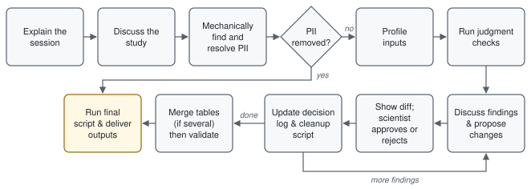

# metadata-cleanup-skill

A [Claude Code](https://claude.com/claude-code) skill that helps a scientist
check, fix, standardize and merge experimental sample metadata (spreadsheets,
CSV/TSV) before submitting it to a repository and to ENA.

Claude walks through the files with the scientist and changes nothing
without their approval. Every agreed change is recorded in a deterministic
Python script, so the cleanup can be audited and run again from the original
files.

**Status:** draft. Remaining work is listed in [BACKLOG.md](BACKLOG.md).

## How a session works



## What a session produces

- corrected TSV files
- a cleanup script that makes every change
- a log of the scientist's decisions

The original files are never modified.

## Installation

Requires [uv](https://docs.astral.sh/uv/), which runs the bundled scripts.

```bash
git clone https://github.com/AmandaBirmingham/metadata-cleanup-skill.git \
    ~/.claude/skills/metadata-cleanup
```

The folder must be named `metadata-cleanup` to match the skill's name. Then
ask Claude Code to clean up your metadata files, or run `/metadata-cleanup`.

## Layout

- `SKILL.md`: the instructions Claude follows
- `references/`: detailed guidance for each stage
- `scripts/`: the check, cleanup-template and diff scripts
- `assets/`: lookup tables (sample types, ENA missing-value terms, ENVO
  terms, metagenome taxa, NCBI taxonomy)
- `tests/`: tests for the scripts

## Development

Run the tests with `./run_tests.sh`; plain `pytest` will not work.
[CLAUDE.md](CLAUDE.md) has the conventions for changing the skill.
